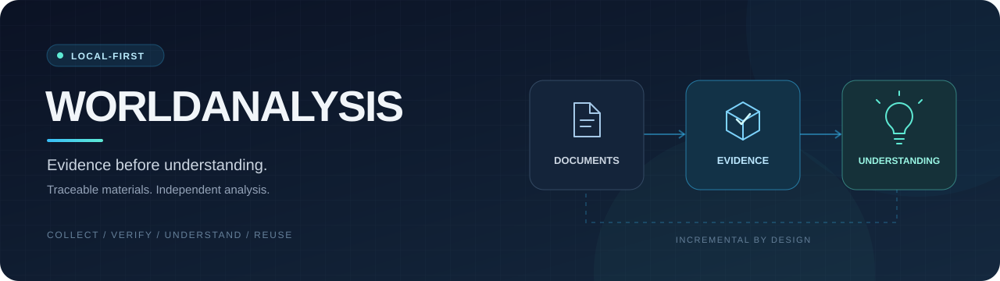
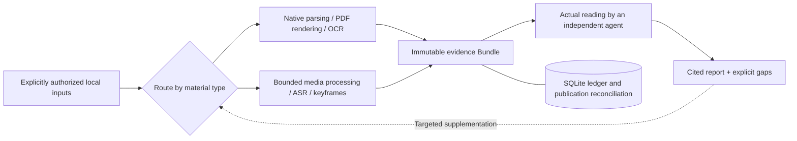

<a id="top"></a>

<p align="center">
  
</p>

<h1 align="center">Worldanalysis</h1>

<p align="center">
  <strong>Turn scattered materials into readable, verifiable, reusable knowledge.</strong><br>
  Local-first processing for mixed materials, with independent agent-assisted analysis.
</p>

<p align="center">
  <a href="README.md">简体中文</a> · <strong>English</strong>
</p>

<p align="center">
  
  
  
  
</p>

<p align="center">
  <a href="#overview">Overview</a> ·
  <a href="#workflow">Workflow</a> ·
  <a href="#quick-start">Quick start</a> ·
  <a href="#capabilities">Capabilities</a> ·
  <a href="#development">Development</a> ·
  <a href="#documentation">Documentation</a>
</p>

> [!IMPORTANT]
> **This is a runnable experimental version, not a fully autonomous course-understanding platform.** Local evidence processing and agent-assisted analysis are implemented. Authorized-source and short-media checks provide limited real-world evidence, not acceptance of entire courses, hundred-hour workloads, or the full project plan.

<a id="overview"></a>

<!-- worldanalysis-library-start -->
## Local library and console

Browse the resource library by topic, or use the course calendar to read projects by publication date, scroll through older entries, and jump to a date. A course title opens its existing resource detail.

The console brings public collection, member link intake, transfer review, local downloads, analysis, independent acceptance, and cleanup together. It can run public collection and workflow checks and retains the existing approvals for transfer and cleanup. See the [operator guide](_ingest/wangzjk-to-pan/v4-review/README.md) for setup, repeatable commands, and local data requirements.
<!-- worldanalysis-library-end -->

## ✨ Overview

Worldanalysis handles projects containing a mixture of text, Office documents, PDFs, images, audio, and video. It separates acquiring and documenting materials from understanding and extending their content:

- **Collection and evidence processing** preserve provenance, source text, and necessary visual evidence, with page, position, or time locators and explicit processing gaps.
- **Independent agent analysis** lets a user-authorized agent read actual evidence and submit cited reports. The program checks task identity, reading receipts, and result contracts.

### Why this approach?

| Design principle | Practical benefit |
| :--- | :--- |
| 🏠 Local first | Source materials and generated artifacts stay local; commercial calls and material egress are disabled by default. |
| 🔎 Traceable evidence | Original content, OCR/ASR derivatives, external facts, and model inferences remain separate. |
| ♻️ Incremental reuse | Reuse evidence only when identity, version, and configuration checks match, avoiding unnecessary re-extraction. |
| 🧩 Decoupled pipelines | Change the analysis model without recollecting all unchanged materials. |
| 🛡️ Honest coverage | Unread, unexplained, resource-limited, or unsupported content remains explicit instead of silently becoming complete. |

<a id="workflow"></a>

## 🧭 Workflow



**Published evidence ≠ evidence read by an agent. Executed OCR/ASR ≠ error-free content. Delivered supplementation ≠ resolved semantic gaps.**

<a id="quick-start"></a>

## 🚀 Quick start

### 1. Prepare the environment

Use **Windows + CPython 3.12**, the environment used for current validation. Start with the minimal TXT workflow, then configure document or media backends as needed.

The following commands use **PowerShell**. Later examples reuse `$py` in the same window; activation scripts and execution-policy changes are not required:

```powershell
git clone https://github.com/greywolf8888/worldanalysis.git
cd worldanalysis

py -3.12 -m venv .venv
$py = ".\.venv\Scripts\python.exe"
& $py -m pip install "jsonschema==4.25.1" Pillow
& $py -B -m worldanalysis --help
```

> [!NOTE]
> Run `python -m worldanalysis` from the source directory; there is no published PyPI package yet. The [Windows launcher](<worldanalysis.cmd>) hardcodes the original development machine's host Python path. Use the virtual-environment commands above on a new machine instead of relying on that launcher.

### 2. Process a local TXT file

```powershell
New-Item -ItemType Directory -Path "手动投放" -Force | Out-Null
Set-Content -Path "手动投放/demo.txt" -Value "Worldanalysis demo: local evidence only." -Encoding utf8

& $py -B -m worldanalysis create-project --project-id demo --topic "Local evidence demo"
& $py -B -m worldanalysis ingest --project demo --no-ocr "手动投放/demo.txt"
& $py -B -m worldanalysis verify --project demo
& $py -B -m worldanalysis status
```

This creates a project and publishes actual TXT evidence, returning fields such as `bundle_id`, `publish_id`, `coverage`, and `gaps`. It **does not automatically generate a summary or report**. Create the example project only once; subsequent imports can use the same project ID.

Inputs must be inside the workspace root. The default root is the current directory; set `--root` before the subcommand to choose another root. Original inputs are not moved, deleted, or executed as code. The Chinese directory names in these examples are intentional and match the application's existing local layout.

### 3. Hand evidence to an authorized agent

```powershell
& $py -B -m worldanalysis analysis next --project demo --model-version "<actual-model-version>"
& $py -B -m worldanalysis analysis read --task "<task-id>" --block "<block-id>"
& $py -B -m worldanalysis analysis complete --task "<task-id>" "<actual-path-to-result.json>"
```

Values in angle brackets are placeholders. Obtain the real task ID, block IDs, and output directory from `analysis next`. Have the authorized agent read the evidence, prepare a result JSON and nonempty report files according to the [analysis result contract](<worldanalysis_agent_devpack_20261110/contracts/analysis.schema.json>), then submit them for validation.

**`analysis read` acknowledges text reading only.** Images and rendered pages require a viewer adapter that actually consumes image bytes and provides matching receipts; an image path is not proof of viewing. The current CLI has no image-opening subcommand; integrate a real viewer through the [Python API `Analysis.open_image(..., opener=...)`](<worldanalysis/analysis.py>). The default `agent_assisted` mode does not call commercial model APIs or borrow subscription credentials.

<details>
<summary><strong>Useful advanced commands</strong></summary>

```powershell
# Read-only hardware, dependency, and local legacy-material metadata inventory; no network
& $py -B -m worldanalysis capabilities

# Pause or resume collection and analysis independently
& $py -B -m worldanalysis control collection pause
& $py -B -m worldanalysis control analysis pause
& $py -B -m worldanalysis control collection resume
& $py -B -m worldanalysis control analysis resume

# Compose existing Bundles from this project without re-extracting
& $py -B -m worldanalysis compose --project demo --bundle "<bundle-a>" --bundle "<bundle-b>"

# Explicitly resume an existing analysis task instead of claiming it twice
& $py -B -m worldanalysis analysis resume --task "<task-id>"

# Inspect the incremental reading scope
& $py -B -m worldanalysis analysis delta --task "<task-id>"
```

Use `--help` to discover image-region, audio-window, and supplementation-delivery commands. Artifact publication and semantic reading remain distinct states.

</details>

<a id="capabilities"></a>

## 🧰 Capabilities and boundaries

| Material or stage | Current implementation | Important boundary |
| :--- | :--- | :--- |
| TXT / Markdown / JSON / CSV / subtitles | Text decoding, continuous blocks, locators, and structural-gap records | Structural errors do not justify discarding original text. |
| DOCX / PPTX / XLSX | Native OOXML extraction of text, tables, image positions, and related objects | No macro, formula, or external-link execution; Office page fidelity is not guaranteed. |
| PDF / images | Native text, image evidence, on-demand page rendering, and local OCR | Scans, vectors, overlays, and image semantics may remain `partial`. |
| Local audio and video | Bounded windows, checkpoints, CPU ASR, visual candidates, and Bundles | Admitted local models are required; sparse keyframes do not guarantee every operation is captured. |
| Incremental processing and recovery | Version binding, evidence reuse, publication reconciliation, and explicit task resumption | Unknown submission states must not be blindly replayed. |
| Websites / cloud drives | Source observation, scope checks, and transfer/readback state interfaces | Limited real-source checks do not establish full-course transport or production acceptance. |

### Dependencies by use case

| Use case | Dependencies |
| :--- | :--- |
| Minimal TXT and contract validation | Python standard library, `jsonschema`, and `Pillow` (also used for input probing) |
| Images and PDFs | `Pillow`, `pypdf`; `pypdfium2` for page rendering |
| Local OCR | `rapidocr-onnxruntime`, `onnxruntime`, and corresponding local weights |
| Media and ASR | `av`, `faster-whisper`, `ctranslate2`, and admitted local models |
| Full document tests | Additional fixture generators such as `python-docx`, `python-pptx`, and `openpyxl` |

The [dependency lock snapshot](<requirements-lock.txt>) records the original validated Windows CPython 3.12 environment. It is not a promise of installation support on every platform and does not include model weights. Native dependencies must match the Python ABI; do not reuse the original binary environment with Python 3.14.

### Still requiring validation or further work

- Full-course transport, sustained recovery, and production reliability from authorized cloud sources to local processing.
- Long-course and hundred-hour workloads, including media coverage calibration.
- Additional real XLSX and mixed digital/scanned-page PDF samples.
- Complete semantic interpretation of complex visuals, vector graphics, formulas, and layouts.
- Real external-verification reader integration and more complete incremental scheduling.

These remain explicit follow-up work. Offline tests and synthetic samples are not substitutes for production acceptance.

<a id="layout"></a>

## 🗂️ Repository layout

```text
worldanalysis/
├── README.md                           # Chinese landing page
├── README.en.md                        # English documentation
├── WORLDANALYSIS.md                     # Original development-environment notes
├── worldanalysis/                      # Python CLI, ledger, extraction, analysis
├── worldanalysis_agent_devpack_20261110/ # Architecture, contracts, prompts, plans
├── tests/                              # Unit and integration regressions
├── docs/assets/                        # README presentation assets
├── requirements-lock.txt               # Original validated dependency snapshot
├── worldanalysis.cmd                   # Original-machine-specific launcher
├── 手动投放/                            # Local inputs; not committed
└── 整理结果/                            # SQLite, evidence, reports; not committed
```

<a id="development"></a>

## 🧪 Development and validation

Run from the repository root in the same PowerShell window:

```powershell
# Minimal environment: ledger and publication regressions
& $py -B -m unittest discover -s tests -p "test_store.py" -v

# Full regression after configuring document / OCR / media dependencies
& $py -B -m unittest discover -s tests -p "test_*.py" -v
```

Tests establish only the behaviors they cover, not successful full-cloud transport, complete reading of real courses, or acceptance of the entire plan. Some real-material acceptance artifacts are ignored and should not be expected in a clone.

Report problems through [Issues](https://github.com/greywolf8888/worldanalysis/issues). Include reproduction steps, relevant tests, and known limitations with changes. Prefer explicitly labeled synthetic material in public examples.

<a id="documentation"></a>

## 📚 Documentation

The following detailed implementation and planning documents are currently in Chinese; this README provides the corresponding English overview and usage guide.

| Entry | Contents |
| :--- | :--- |
| [简体中文](<README.md>) | Chinese version of this introduction and usage guide. |
| [Local execution notes](<WORLDANALYSIS.md>) | Original environment, historical checks, and remaining scope; some material paths exist only locally. |
| [Development package overview](<worldanalysis_agent_devpack_20261110/README.md>) | Intent, module boundaries, and design index; plans are not claims of completed implementation. |
| [Architecture and contracts](<worldanalysis_agent_devpack_20261110/02_ARCHITECTURE_AND_CONTRACTS.md>) | Collection, analysis, ledger, and evidence interfaces. |
| [Analysis agent specification](<worldanalysis_agent_devpack_20261110/04_ANALYSIS_AGENT.md>) | Reading, citations, verification, supplementation, and incremental updates. |
| [Implementation and acceptance plan](<worldanalysis_agent_devpack_20261110/06_IMPLEMENTATION_AND_ACCEPTANCE.md>) | Phased scope and real-scenario acceptance criteria. |
| [CLI implementation](<worldanalysis/__main__.py>) | Source of truth for current commands, arguments, and routing. |

<a id="safety"></a>

## 🔐 Safety, authorization, and licensing

- Process explicitly authorized sources only. Cloud paths are policy-restricted, by default to `/apps/教育分析学习/`; a model-generated plan does not grant permission.
- Commercial budgets default to zero. Material egress and new Baidu AI generation are disabled by default. Browser and subscription credentials are not automatically exported or borrowed.
- Do not execute scripts, macros, project attachments, or formulas found in materials, or bypass payment, access controls, or site restrictions.
- Do not submit raw courses, contact details, QR codes, signed download URLs, databases, or local models as public examples. Review staged changes before pushing; [Git ignore rules](<.gitignore>) do not sanitize tracked files or history.
- **No project license has been declared yet.** Do not assume MIT or Apache-2.0 terms for use or redistribution. Third-party dependencies and materials retain their own licenses and authorization requirements.

---

<p align="center">
  <strong>Evidence before understanding. Preserve uncertainty instead of manufacturing completion.</strong><br>
  <a href="#top">Back to top ↑</a>
</p>
