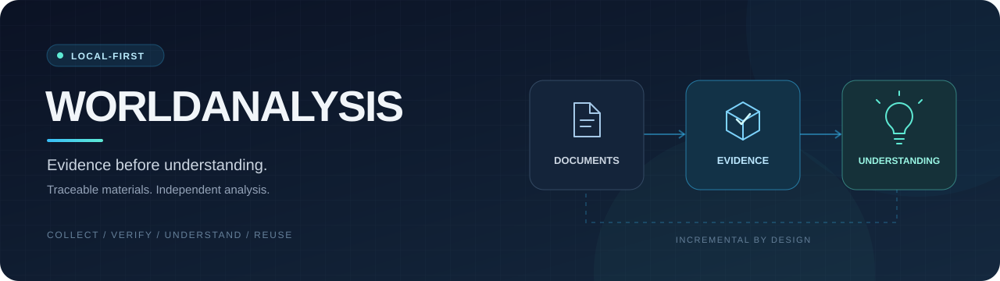
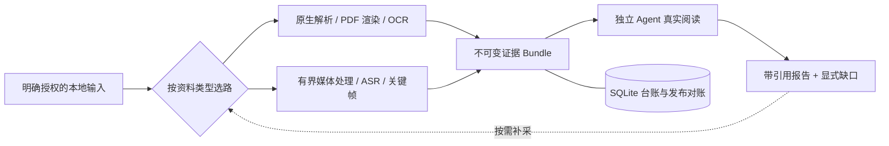

<a id="top"></a>

<p align="center">
  
</p>

<h1 align="center">Worldanalysis</h1>

<p align="center">
  <strong>让杂乱资料，成为可阅读、可核验、可复用的知识。</strong><br>
  本地优先的混合资料处理与独立 Agent 分析工具。
</p>

<p align="center">
  <strong>简体中文</strong> · <a href="README.en.md">English</a>
</p>

<p align="center">
  
  
  
  
</p>

<p align="center">
  <a href="#overview">项目介绍</a> ·
  <a href="#workflow">工作流程</a> ·
  <a href="#quick-start">快速开始</a> ·
  <a href="#capabilities">能力边界</a> ·
  <a href="#development">开发验证</a> ·
  <a href="#documentation">文档导航</a>
</p>

> [!IMPORTANT]
> **当前为可运行的实验版本，不是全自动课程理解平台。** 项目已实现本地证据加工与 Agent 辅助分析；真实授权来源与短媒体样本也有阶段性验证，但不代表整课、百小时负载或全部计划已验收。

<a id="overview"></a>

<!-- worldanalysis-library-start -->
## 本机资源库与控制台

资源库按主题检索和选择资料。课程表按发布日期分组，向下滚动即可继续浏览，也可直接跳到指定日期。点击课程标题可打开原先的资源详情。

控制台集中查看公开采集、会员入口、转存、本地下载、正式分析、独立验收和清理。公开采集和全链路检查可直接运行，转存与清理沿用既有确认流程。启动方法、可重复执行的脚本和本地数据要求见[资源库运行指南](_ingest/wangzjk-to-pan/v4-review/README.md)。
<!-- worldanalysis-library-end -->

## ✨ 项目介绍

Worldanalysis 面向 TXT、Office、PDF、图片和音视频混合存在的资料项目，将“取得并证明材料”与“理解并拓展知识”拆成两个独立环节：

- **采集与证据加工**：保留来源、原文与必要视觉证据，记录页码、位置或时间范围，以及尚未处理的缺口。
- **独立 Agent 分析**：由用户授权的 Agent 阅读真实证据，提交带引用的报告；程序检查任务身份、读取回执与结果契约。

### 为什么这样设计？

| 设计重点 | 实际价值 |
| :--- | :--- |
| 🏠 本地优先 | 原始材料与处理产物保留在本地；默认禁用商业调用和材料外发。 |
| 🔎 证据可追溯 | 原始内容、OCR/ASR 派生内容、外部事实与模型推断分层，不混为一谈。 |
| ♻️ 增量复用 | 对符合身份、版本和配置约束的证据复用结果，避免无变化资料重复提取。 |
| 🧩 采集、分析解耦 | 可以更换分析模型，无需因此重新采集全部未变材料。 |
| 🛡️ 如实保留缺口 | 未读取、未解释、资源受限或不支持的内容保持显式状态，不静默当作完成。 |

<a id="workflow"></a>

## 🧭 工作流程



**证据已发布 ≠ Agent 已阅读；OCR/ASR 已执行 ≠ 内容无误；补采已交付 ≠ 语义缺口已解决。**

### 网盘视频的新采集顺序

当前选定流程为：**完整枚举指定目录 → 对全部视频分别取得平台文稿和课件 → 第一遍结束后只补确认的文字/画面缺口 → 复用证据库与 Obsidian 呈现**。不新增完整本地视频或音频文件。

新增 `worldanalysis.platform_pass` 调度入口和本地产物验证；文稿、课件分别记账，等待中的生成只对账，覆盖未知进入复核。该入口没有内置在线浏览器采集或远程补采执行器。本轮真实访问被宿主站点策略阻止，未将历史清单或离线测试记作实网完成。见[两遍采集入口与执行记录](docs/platform-first-20261116/README.md)。

<a id="quick-start"></a>

## 🚀 快速开始

### 1. 准备环境

推荐 **Windows + CPython 3.12**，这是当前项目采用的验证环境。先用最小依赖跑通 TXT 流程，再按需配置文档或媒体后端。

以下命令使用 **PowerShell**，后续示例沿用同一窗口中的 `$py` 变量，无需激活脚本或修改系统执行策略：

```powershell
git clone https://github.com/greywolf8888/worldanalysis.git
cd worldanalysis

py -3.12 -m venv .venv
$py = ".\.venv\Scripts\python.exe"
& $py -m pip install "jsonschema==4.25.1" Pillow
& $py -B -m worldanalysis --help
```

> [!NOTE]
> 当前通过源码目录运行 `python -m worldanalysis`，尚未提供 PyPI 安装包。[Windows 启动器](<worldanalysis.cmd>) 固定引用原开发机的宿主 Python 路径，新环境请使用上面的虚拟环境命令，不要直接依赖该启动器。

### 2. 跑通一份本地 TXT

```powershell
New-Item -ItemType Directory -Path "手动投放" -Force | Out-Null
Set-Content -Path "手动投放/demo.txt" -Value "Worldanalysis demo: local evidence only." -Encoding utf8

& $py -B -m worldanalysis create-project --project-id demo --topic "本地资料示例"
& $py -B -m worldanalysis ingest --project demo --no-ocr "手动投放/demo.txt"
& $py -B -m worldanalysis verify --project demo
& $py -B -m worldanalysis status
```

这一步创建项目并发布真实 TXT 证据，返回 `bundle_id`、`publish_id`、`coverage` 与 `gaps` 等信息；**不会自动生成摘要或报告**。示例项目只需创建一次，后续导入可继续使用同一个项目 ID。

输入必须位于工作区根目录内；默认根目录是当前目录，也可在子命令前通过 `--root` 指定。原始输入不会被移动、删除或作为代码执行。

### 3. 交给授权 Agent 分析

```powershell
& $py -B -m worldanalysis analysis next --project demo --model-version "<实际模型版本>"
& $py -B -m worldanalysis analysis read --task "<task-id>" --block "<block-id>"
& $py -B -m worldanalysis analysis complete --task "<task-id>" "<result.json 的实际路径>"
```

尖括号内容均为占位符。先从 `analysis next` 返回值取得真实任务、块 ID 和输出目录；由授权 Agent 完成阅读，按[分析结果契约](<worldanalysis_agent_devpack_20261110/contracts/analysis.schema.json>)准备结果 JSON 与非空报告，再提交验收。

**`analysis read` 仅确认文本阅读。** 图片或页面渲染需要真正消费图像字节的查看适配器及对应回执，不能用图片路径代替“看过”。当前 CLI 没有图像打开子命令；需通过 [Python API `Analysis.open_image(..., opener=...)`](<worldanalysis/analysis.py>) 接入实际查看器。默认 `agent_assisted` 模式不调用商业模型 API，也不借用订阅凭据。

<details>
<summary><strong>常用进阶命令</strong></summary>

```powershell
# 只读设备、依赖和本地历史材料元数据盘点，不访问网络
& $py -B -m worldanalysis capabilities

# 分别暂停或恢复采集、分析
& $py -B -m worldanalysis control collection pause
& $py -B -m worldanalysis control analysis pause
& $py -B -m worldanalysis control collection resume
& $py -B -m worldanalysis control analysis resume

# 组合本项目已有 Bundle，不重新提取
& $py -B -m worldanalysis compose --project demo --bundle "<bundle-a>" --bundle "<bundle-b>"

# 中断后显式恢复已有分析任务，避免重复领取
& $py -B -m worldanalysis analysis resume --task "<task-id>"

# 查询增量阅读范围
& $py -B -m worldanalysis analysis delta --task "<task-id>"
```

图像区域、音频时间窗和补采交付等命令可通过 `--help` 查看。其产物发布与语义阅读是不同状态。

</details>

<a id="capabilities"></a>

## 🧰 能力与边界

| 资料或环节 | 当前实现 | 需要注意 |
| :--- | :--- | :--- |
| TXT / Markdown / JSON / CSV / 字幕 | 原文解码、连续分块、定位与结构缺口记录 | 结构错误不等于可以丢弃原文。 |
| DOCX / PPTX / XLSX | 原生 OOXML 解析，记录文本、表格、图片位置等 | 不运行宏、公式或外链；不保证 Office 页面视觉还原。 |
| PDF / 图片 | 原生文字、图像证据、按需页面渲染与本地 OCR | 扫描、矢量、叠加布局及图像语义可能保持 `partial`。 |
| 本地音视频 | 有界窗口、检查点、CPU ASR、画面候选与 Bundle | 需要已准入本地模型；稀疏关键帧不保证覆盖每个操作。 |
| 增量与恢复 | 版本绑定、证据复用、发布对账、显式任务恢复 | 未知提交状态不能盲目重放。 |
| 网站 / 云盘 | 来源观察、范围校验、转存与读回状态接口 | 真实来源有阶段性验证，不代表整课全量运输或生产验收。 |
| 已有平台资料包 | 本地字幕、文稿、笔记与图片接入现有 Store；附件变化形成新修订 | 离线入口，不自动访问百度；来源声明、全文与关键帧覆盖保持待核验。 |
| Obsidian 呈现 | 已发布 Bundle 导出 Markdown、本地图像、个人笔记和缺口 | 只读证据；导出不代表网盘采集、全文覆盖或分析已完成。 |

已有百度资料可通过独立入口 `python -m worldanalysis.platform_materials` 导入，再使用 `python -m worldanalysis.obsidian` 呈现。具体格式、PowerShell 命令、人工编辑保护和已验证边界见[百度课程资料接入与 Obsidian 呈现](<docs/obsidian-20261115/README.md>)。

### 按需依赖

| 使用场景 | 对应依赖 |
| :--- | :--- |
| 最小 TXT 与契约校验 | Python 标准库、`jsonschema`、`Pillow`（当前输入探测也会使用） |
| 图片与 PDF | `Pillow`、`pypdf`；页面渲染使用 `pypdfium2` |
| 本地 OCR | `rapidocr-onnxruntime`、`onnxruntime` 及对应本地权重 |
| 音视频与 ASR | `av`、`faster-whisper`、`ctranslate2` 及已准入本地模型 |
| 完整文档测试 | 另需 `python-docx`、`python-pptx`、`openpyxl` 等样本生成依赖 |

[依赖锁定清单](<requirements-lock.txt>)记录原 Windows CPython 3.12 验证环境，不是所有平台均已验证的安装承诺，也不包含模型权重。原生库必须匹配 Python ABI；不要将原环境的二进制依赖直接搬给 Python 3.14 使用。

### 仍需验证或完善

- 真实云盘来源到本地处理的整课全量运输、持续恢复与生产可靠性。
- 长课程、百小时级负载及媒体策略的覆盖校准。
- 真实 XLSX、同一文件内混合数字/扫描页 PDF 等样本补齐。
- 复杂视觉、矢量图、公式与布局的完整语义解释。
- 外部核验 reader 的实际接入与更完整的增量调度。

这些是明确保留的后续工作，不以离线测试或合成样本代替生产验收。

<a id="layout"></a>

## 🗂️ 项目结构

```text
worldanalysis/
├── README.md                           # 中文首页
├── README.en.md                        # English documentation
├── WORLDANALYSIS.md                     # 原开发环境执行说明
├── worldanalysis/                      # Python CLI、台账、提取与分析
├── worldanalysis_agent_devpack_20261110/ # 架构、契约、提示词与验收规划
├── tests/                              # 单元与集成回归
├── docs/assets/                        # README 展示素材
├── requirements-lock.txt               # 原验证环境依赖快照
├── worldanalysis.cmd                   # 原开发机专用启动器
├── 手动投放/                            # 本地输入，不提交 Git
└── 整理结果/                            # SQLite、证据、报告，不提交 Git
```

<a id="development"></a>

## 🧪 开发验证

在项目根目录、上述 PowerShell 窗口中运行：

```powershell
# 最小环境：台账与发布流程回归
& $py -B -m unittest discover -s tests -p "test_store.py" -v

# 配置完整文档 / OCR / 媒体依赖后：完整回归
& $py -B -m unittest discover -s tests -p "test_*.py" -v
```

测试仅证明对应覆盖的行为，不等于云盘全量运输成功、实际课程完整读完或全部计划通过。真实本地材料的部分验收产物被忽略，不应假定它们随克隆分发。

欢迎通过 [Issues](https://github.com/greywolf8888/worldanalysis/issues) 反馈问题。提交改动时请附可复现步骤、相关测试与已知限制；示例优先使用明确标记的合成材料。

<a id="documentation"></a>

## 📚 文档导航

| 入口 | 内容 |
| :--- | :--- |
| [English documentation](<README.en.md>) | 与本页对应的英文介绍和使用说明。 |
| [本地执行说明](<WORLDANALYSIS.md>) | 原环境入口、历史实测与未完成范围；部分材料路径仅本机存在。 |
| [本地课程教材开发文档](<docs/课程资料整理与 Obsidian 教材制作手册.md>) | 从课程文件夹入库到逐集复核、配图和 Obsidian 发布。 |
| [百度资料与 Obsidian](<docs/obsidian-20261115/README.md>) | 参考项目深度研究、本地资料接入、Vault 导出、验证记录和真实采集剩余工作。 |
| [开发包总览](<worldanalysis_agent_devpack_20261110/README.md>) | 项目意图、模块划分与设计文档索引；规划不等于全部已实现。 |
| [架构与数据契约](<worldanalysis_agent_devpack_20261110/02_ARCHITECTURE_AND_CONTRACTS.md>) | 采集、分析、台账与证据的接口边界。 |
| [分析 Agent 规范](<worldanalysis_agent_devpack_20261110/04_ANALYSIS_AGENT.md>) | 阅读、引用、核验、补采及增量更新要求。 |
| [实施与验收规划](<worldanalysis_agent_devpack_20261110/06_IMPLEMENTATION_AND_ACCEPTANCE.md>) | 分阶段范围与真实场景验收标准。 |
| [CLI 实现](<worldanalysis/__main__.py>) | 当前命令、参数与路由的事实来源。 |

<a id="safety"></a>

## 🔐 安全、授权与许可

- 仅处理明确授权的来源；云盘范围由策略约束，默认限定为 `/apps/教育分析学习/`，不以模型计划替代授权。
- 默认商业预算为零、材料外发禁用、新增百度 AI 生成禁用；不自动导出或借用浏览器/订阅凭据。
- 不执行材料中的脚本、宏、工程附件或公式；不绕过付费、访问控制或站点限制。
- 原始课程、联系方式、二维码、带签名下载链接、数据库与本地模型不应作为公开示例提交。推送前检查暂存区；[Git 忽略规则](<.gitignore>)不是已跟踪文件或历史记录的脱敏工具。
- 仓库目前**尚未声明项目许可证**，不要默认按 MIT 或 Apache-2.0 使用、再分发；第三方依赖和材料分别遵循其自身许可与授权范围。

---

<p align="center">
  <strong>先有证据，再有理解；保留不确定性，而不是制造完成感。</strong><br>
  <a href="#top">返回顶部 ↑</a>
</p>
